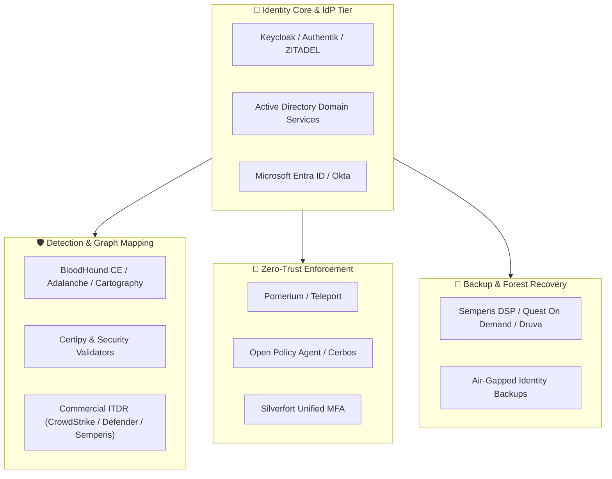

# 🛡️ Awesome IAM & Cloud Identity Backup

  <strong>Curated Directory of Identity Threat Detection & Response (ITDR), Active Directory Disaster Recovery, and Cloud IAM Security Solutions</strong>

  
  
  
  
  

---

## 📌 Executive Summary & Key Highlights

Modern cyberattacks increasingly bypass network perimeters to compromise the identity control plane. This repository tracks production-grade **SaaS platforms** and **open-source security tools** designed for:

- 🛡️ **Identity Threat Detection & Response (ITDR)**: Continuous detection of credential harvesting, privilege escalation, and lateral movement in Active Directory and cloud identity environments.
- 🌲 **Active Directory Forest Recovery & Resilience**: Rapid automated restoration of on-premises AD, hybrid domain controllers, and cloud identities following catastrophic ransomware infections.
- ☁️ **Cloud Identity & Entitlement Governance (CIEM)**: Auditing non-human identities, misconfigured IAM permissions, and attack pathways across Entra ID, AWS IAM, GCP, and Okta.
- 🔓 **Open-Source Zero-Trust Foundations**: Self-hosted IAM identity providers, graph-based attack-path visualizers, and security audit utilities.

---

## 📑 Table of Contents

- [📊 Sector Overview & Market Dynamics](#-sector-overview--market-dynamics)
- [🏢 SaaS & Enterprise Hosted Platforms](#-saas--enterprise-hosted-platforms)
- [💻 Open-Source GitHub Projects](#-open-source-github-projects)
- [🧩 Architecture Patterns & Blueprints](#-architecture-patterns--blueprints)
- [🤝 How to Contribute](#-how-to-contribute)
- [💖 Support & Sponsorship](#-support--sponsorship)
- [📈 Star History](#-star-history)
- [⚠️ Disclaimer](#-disclaimer)

---

## 📊 Sector Overview & Market Dynamics

The global **Identity and Access Management (IAM)** and **Identity Threat Detection & Response (ITDR)** market is valued at approximately **$25B to $30B**, with the hyper-growth ITDR and identity resilience segment expanding at a **CAGR exceeding 20%** (projected to reach $13B+ by 2028).

The market structure is **moderately fragmented**:
1. **Consolidated Cyber Titans**: Giant multi-product security vendors (Microsoft, Palo Alto Networks, CrowdStrike, and Zscaler) are consolidating identity posture with endpoint detection (XDR) and zero-trust network access (ZTNA).
2. **Pure-Play Resilience Specialists**: Niche category champions (Semperis, Silverfort, Quest Software, and Druva) continue to capture mission-critical enterprise workloads through specialized Active Directory forest recovery, non-human identity governance, and agentless hybrid protocol firewalls.
3. **Open-Source Innovation Hub**: Self-hosted protocols and graph analytics engines (Keycloak, Authentik, BloodHound, and Kanidm) empower teams to build independent, vendor-agnostic zero-trust authentication stacks.

---

## 🏢 SaaS & Enterprise Hosted Platforms

Enterprise identity security platforms prioritized and sorted by company capitalization/valuation (descending):

| Platform | Core Capabilities | Company Size (Valuation / Revenue) | Pricing Model & Starting Tier | Free Tier / Trial Evaluation |
| :--- | :--- | :--- | :--- | :--- |
| **[Microsoft Defender for Identity](https://www.microsoft.com/en-us/security/business/siem-and-xdr/microsoft-defender-for-identity)** | Cloud-based sensor network monitoring on-premises Active Directory and hybrid identity signals for advanced suspicious behavior. | ~$3.85T+ Market Cap (~$245B+ Annual Revenue) | ~$5.50/user/month (annual commitment, list price); ~$6.60/user/month (month-to-month); bundled in EMS E5 / M365 E5 Security | 30-day to 90-day free evaluation trial (available via Microsoft Defender admin portal) |
| **[Palo Alto Cortex XDR Identity](https://www.paloaltonetworks.com/)** | Identity threat telemetry, analytics, and behavioral analytics integrated directly inside the Cortex XDR ecosystem. | ~$240B+ Market Cap (~$8B+ Annual Revenue) | Starting at ~$70.00/endpoint/year (~$5.83/endpoint/month, G-Cloud list); negotiable enterprise pricing ~$25–$45/endpoint/year | 30-day to 60-day guided Proof-of-Concept (PoC) evaluation via sales/partners |
| **[CrowdStrike Falcon Identity Protection](https://www.crowdstrike.com/)** | ITDR module within the Falcon platform that blocks credential-based lateral movement across Active Directory and Microsoft Entra ID in real time. | ~$240B+ Market Cap (~$4B+ Annual Revenue) | Standalone identity protection benchmarked at ~$3.00–$5.00/active identity/month (billed annually); custom enterprise tier add-on | 15-day free trial of the Falcon platform with identity module testing enabled (no credit card required) |
| **[Zscaler ITDR](https://www.zscaler.com/)** | Identity threat detection, deception decoys, and posture management (ITDR) designed to stop lateral movement and active credential theft. | ~$31B+ Market Cap (~$3.35B Annual Revenue) | Platform enterprise plans start from ~$72.00–$120.00/user/year; ITDR module priced via custom enterprise agreements | Guided Proof-of-Concept (PoC) and free interactive identity posture assessment via sales |
| **[SentinelOne Singularity Identity](https://www.sentinelone.com/)** | Real-time identity protection, deception decoys, and AD privilege monitoring natively unified into Singularity XDR. | ~$8B Market Cap (~$800M+ Annual Revenue) | Starting at ~$229.99/endpoint/year on Singularity Commercial bundle (includes identity threat protection) | 14-day to 30-day Proof-of-Concept (PoC) evaluation trial upon partner/sales request |
| **[Quest On Demand Recovery](https://www.quest.com/)** | Cloud-native disaster recovery, backup, and restoration engine for Microsoft Entra ID (Azure AD), hybrid tenants, and Office 365 objects. | ~$5.4B Valuation (Acquired by Clearlake Capital; ~$1B Revenue) | Starting at ~£9.18/managed user/year (approx. $11.50/user/year, G-Cloud list price) | 30-day full-featured free trial |
| **[Druva Identity Workloads Protection](https://www.druva.com/)** | Cyber-resilience and air-gapped backup designed specifically for cloud identity services, Microsoft 365, and enterprise user workloads. | ~$2B+ Valuation (~$200M+ ARR / ~$304M Revenue) | Endpoint/identity protection modules start at ~$4.00–$8.00/user/month; cloud workloads billed consumption-based | 30-day self-service free trial with full platform access (no credit card required) |
| **[Semperis Directory Services Protector (DSP)](https://www.semperis.com/)** | Purpose-built platform for continuous hybrid Active Directory threat detection, cyber-first forest recovery, and automated attack rollback. | ~$1B+ Unicorn Valuation (~$100M+ ARR) | Enterprise subscription scaled by protected identity count (quote-based enterprise contract; community editions free) | Free community assessment tools (Purple Knight & Forest Druid) forever; 30-day guided enterprise PoC |
| **[Silverfort Unified Identity Protection](https://www.silverfort.com/)** | Agentless identity protection platform extending MFA, posture defense, and ITDR across legacy systems, command-line interfaces, and hybrid environments. | ~$1B Unicorn Valuation (~$82M+ Revenue / 100%+ YoY ARR Growth) | Starting from ~£7.00/user/year (Silverfort Essentials, G-Cloud list) up to ~£30.00–£45.00/user/year for unified protection tiers | 14-day to 30-day custom Proof-of-Concept (PoC) trial on request |
| **[Authomize (Delinea)](https://www.delinea.com/)** | Comprehensive Cloud Infrastructure Entitlement Management (CIEM) and continuous Identity Threat Detection & Response across multi-cloud ecosystems. | Acquired by Delinea ($400M+ ARR / PE-backed by TPG & Thoma Bravo) | Cloud-native platform subscription scaled per managed identity and cloud integration (enterprise quote-based) | Guided Proof-of-Concept (PoC) / free trial evaluation upon direct request |

---

## 💻 Open-Source GitHub Projects

Curated open-source projects for identity protection, IAM, attack-path auditing, and directory infrastructure. **Sorted by GitHub stargazers count (descending)**:

1. **[Keycloak](https://github.com/keycloak/keycloak)**   
   *Widely adopted enterprise open-source Identity and Access Management solution providing SSO, identity brokering, user federation, and granular access tokens via OpenID Connect (OIDC), OAuth 2.0, and SAML 2.0.*

2. **[Authelia](https://github.com/authelia/authelia)**   
   *Lightweight, open-source authentication and authorization companion server providing multi-factor authentication (2FA/FIDO2 WebAuthn/Duo) and single sign-on (SSO) for web portals behind reverse proxies (Nginx, Traefik, Caddy).*

3. **[authentik](https://github.com/goauthentik/authentik)**   
   *Modern, highly customizable open-source identity provider emphasizing flexible authentication pipelines, user self-service, built-in outpost proxies, and multi-tenant IAM governance.*

4. **[Teleport](https://github.com/gravitational/teleport)**   
   *Identity-aware multi-protocol access proxy for infrastructure, SSH servers, Kubernetes clusters, web applications, and databases, replacing static credentials with cryptographically bound short-lived identity certificates.*

5. **[Impacket](https://github.com/fortra/impacket)**   
   *Essential library of Python classes for interacting with network protocols (SMB, MSRPC, Kerberos, NTLM, LDAP). Indispensable for security auditing, penetration testing, and Active Directory protocol verification.*

6. **[ZITADEL](https://github.com/zitadel/zitadel)**   
   *Cloud-native "Identity Infrastructure for developers" built in Go, featuring turnkey multi-tenancy, audit logging, B2B organization mapping, and full OpenID Connect / Passkey authentication flows.*

7. **[Ory Kratos](https://github.com/ory/kratos)**   
   *Headless, API-first identity and user management service designed to power cloud-native software architectures, with self-service registration, multi-factor security, and passwordless authentication.*

8. **[Open Policy Agent (OPA)](https://github.com/open-policy-agent/opa)**   
   *General-purpose policy engine that enables unified, context-aware policy enforcement across microservices, Kubernetes pods, cloud IAM roles, and API gateways via declarative Rego code.*

9. **[Dex IdP](https://github.com/dexidp/dex)**   
   *Pluggable open-source identity broker using OpenID Connect to drive authentication for enterprise apps and Kubernetes clusters against LDAP, SAML, GitHub, and corporate identity providers.*

10. **[Scout Suite](https://github.com/nccgroup/ScoutSuite)**   
    *Multi-cloud security auditing engine by NCC Group that assesses IAM configurations, cross-account trust boundaries, and credential risks across AWS, Azure, GCP, and Alibaba Cloud.*

11. **[Kanidm](https://github.com/kanidm/kanidm)**   
    *Fast, memory-safe identity management and directory server written in Rust, engineered for high security, OAuth 2.0/OIDC integration, RADIUS, PAM, and native WebAuthn passwordless support.*

12. **[Pomerium](https://github.com/pomerium/pomerium)**   
    *Identity-aware reverse proxy and Zero Trust Access gateway that authenticates and authorizes traffic against your identity provider on every request without requiring client VPNs.*

13. **[Cerbos](https://github.com/cerbos/cerbos)**   
    *Scalable, context-aware authorization layer that decouples role and attribute-based access control (RBAC/ABAC) into centralized, declarative YAML policies.*

14. **[Cartography](https://github.com/cartography-cncf/cartography)**   
    *Python-based graph mapper that pulls infrastructure assets, IAM roles, users, and permissions into a Neo4j graph database to uncover dangerous identity blast radiuses across AWS, GCP, and Okta.*

15. **[Certipy](https://github.com/ly4k/Certipy)**   
    *Specialized Python toolkit for enumerating and abusing Active Directory Certificate Services (AD CS) misconfigurations and vulnerable certificate templates.*

16. **[BloodHound Community Edition](https://github.com/SpecterOps/BloodHound)**   
    *Gold standard for mapping Active Directory and Microsoft Entra ID relationships into a graph to visually discover hidden attack paths leading to Domain Admin and Tier 0 control planes.*

17. **[Cloudsplaining](https://github.com/salesforce/cloudsplaining)**   
    *AWS IAM security assessment tool by Salesforce that identifies permission creep, overly permissive Wildcard actions, and privilege escalation vulnerabilities in IAM policies.*

18. **[Adalanche](https://github.com/lkarlslund/Adalanche)**   
    *Active Directory and Microsoft Entra ID ACL visualizer that calculates effective permissions and immediate attack paths across users, security groups, and domain assets.*

19. **[FreeIPA](https://github.com/freeipa/freeipa)**   
    *Integrated security information management solution for Linux/Unix networks combining 389 Directory Server (LDAP), MIT Kerberos, Dogtag Certificate System, NTP, and DNS.*

20. **[Samba Active Directory](https://github.com/samba-team/samba)**   
    *Free software re-implementation of the SMB networking protocol and Active Directory Domain Controller (AD DC), powering self-hosted directory forests without Windows Server licensing.*

---

## 🧩 Architecture Patterns & Blueprints

---

## 🤝 How to Contribute

Contributions are warmly welcomed! Help build the definitive open reference for cloud identity resilience:

1. **Fork the Repository** on GitHub.
2. **Review Formatting**: Follow the tabular layout for SaaS solutions or include star badges linked to stargazers for open-source tools.
3. **Verify Links & Pricing**: Keep corporate figures, free-trial conditions, and tool descriptions factual and verified.
4. **Submit a Pull Request** with a descriptive summary of your contribution.

---

## 💖 Support & Sponsorship

If this curated reference saves you time, enhances your identity security posture, or helps your organization plan for cyber-resilience:

- ⭐ **Star this repository** to help others discover it.
- 🍴 **Fork and share** with colleagues in DevSecOps, Blue Teams, and Identity Engineering.
- ☕ **Buy a coffee & sponsor**: Support continuous curation and research at the [**GitHub Sponsors Dashboard**](https://github.com/sponsors/ishandutta2007).

---

## 📈 Star History

---

## ⚠️ Disclaimer

- This repository is a community-curated educational and architectural index — not financial, security, or legal advice.
- The identity control plane represents Tier-0 infrastructure. Always perform security reviews and validate configurations against least-privilege standards before deploying identity tools into production.

---

Made with care for identity engineers, DevSecOps architects, and cybersecurity defenders.

